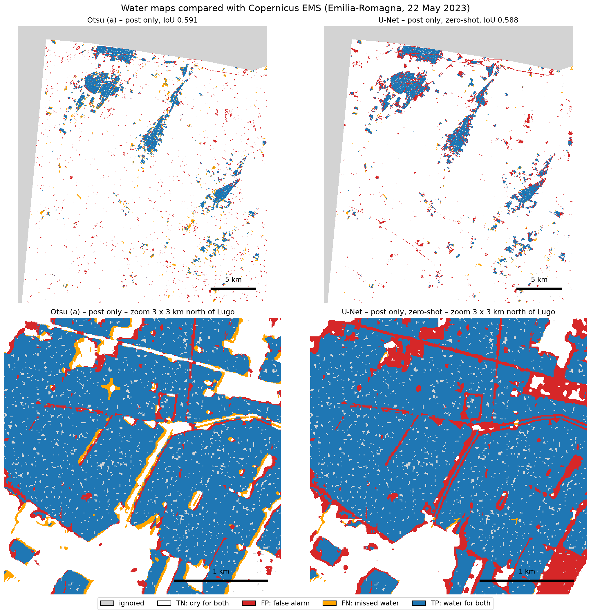
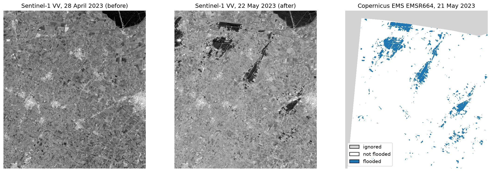
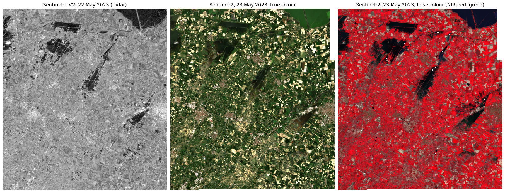

# Flood Mapping in Emilia-Romagna with Sentinel-1 SAR

Mapping the **May 2023 Emilia-Romagna flood** (Italy) from **Sentinel-1 radar images**, comparing a classical thresholding method (**Otsu**) with a **small U-Net written from scratch in PyTorch**. The U-Net is trained on a public dataset of floods around the world (**Sen1Floods11**) and applied **zero-shot** to Italy. Both methods are scored against the official **Copernicus Emergency Management Service (EMS)** flood map.

Everything is in one notebook: [`FloodMappingEmiliaRomagnaS1.ipynb`](FloodMappingEmiliaRomagnaS1.ipynb). It explains every step and keeps a **decision log** of the choices made, including the dead ends.

## Results at a glance

On a 29 × 32 km area around Lugo (Bassa Romagna), against the EMS reference map:

| Method | Input | IoU | Precision | Recall | F1 |
|---|---|---|---|---|---|
| **U-Net (zero-shot)** | post-event image (VV + VH) | **0.622** | 0.662 | **0.910** | **0.767** |
| Otsu (a) | post-event image (VV) | 0.598 | **0.706** | 0.796 | 0.748 |
| Otsu (b), change detection | post − pre difference (VV) | 0.549 | 0.667 | 0.756 | 0.709 |

- The U-Net, which **never saw Italy during training**, beats the best Otsu baseline by **+0.024 IoU**.
- It finds much more of the flooded area (recall 0.91 vs 0.80; missed pixels drop from 86k to 38k), at the cost of more false alarms (196k vs 140k).
- On the Sen1Floods11 test set the same U-Net reaches **IoU 0.668**: going to a new country and a new flood costs only about 0.05 IoU.



*Blue: water for both the method and EMS. Red: false alarm. Orange: water missed. Grey: not evaluated. Bottom row: 3 × 3 km zoom north of Lugo.*

## Why this project

Floods are among the most frequent and costly natural disasters in Europe. During an emergency, clouds usually cover the affected area, so optical satellites can't see the water. **Synthetic Aperture Radar (SAR)** works through clouds and at night. On SAR images, calm water acts like a mirror and reflects the radar pulse away from the satellite, so it looks **dark**. This makes SAR the standard tool for rapid flood mapping.

The project asks two questions:
1. How far can a simple, physics-based threshold (Otsu) go?
2. Does a small deep-learning model trained on *other* floods generalize to a new event (**domain shift**)?

## Study area and data

### Event

In May 2023 Emilia-Romagna was hit by two waves of extreme rain. The first caused floods on **2–3 May** (Copernicus EMS activation EMSR659). The second fell on already saturated soil: more than 20 rivers overflowed on **16–17 May**, and the plain around **Lugo, Conselice and Bagnacavallo** stayed under water for weeks (activation **EMSR664**).

Study area: **11.85–12.20 °E, 44.30–44.58 °N** (about 29 × 32 km), on a 10 m grid in UTM zone 32N (2901 × 3214 pixels).

### Data

| Data | Details | Role |
|---|---|---|
| **Sentinel-1 GRD**, VV + VH | **Post: 22 May 2023**, 05:19 UTC, descending, relative orbit 95 (first pass after the peak) · **Pre: 28 April 2023**, same orbit. σ⁰ (sigma0-ellipsoid) converted to dB, downloaded with **openEO** from the Copernicus Data Space Ecosystem | input |
| **Copernicus EMS EMSR664**, product AOI01 DEL MONIT03 | Flood polygons from a COSMO-SkyMed image of **21 May 2023, 16:50 UTC** (12 h before our Sentinel-1 pass), rasterized on the Sentinel-1 grid | reference ("ground truth") |
| **Sen1Floods11**, hand-labeled part | Sentinel-1 chips of 512 × 512 px (VV, VH in dB) from 11 floods worldwide, with water drawn by hand. Official split: 252 train / 89 valid / 90 test chips (Bolivia hold-out not used) | U-Net training and test |
| **Sentinel-2 L2A** | **23 May 2023**, true and false colour | visual check only |

Why these choices:
- **Same relative orbit for pre and post** → same viewing geometry, so the two images can be compared pixel by pixel. Only Sentinel-1A was operating in 2023 (12-day repeat cycle).
- **10 May rejected as pre-event image**: water from the 2–3 May flood was still on the ground.
- **σ⁰ rather than terrain-flattened γ⁰**: Sen1Floods11 was prepared as σ⁰ in dB, so the U-Net sees the same kind of input in training and in Italy. On a flat plain the difference is small.

**Reference labels:** 1 = flooded (4.5% of pixels), 0 = not flooded (79.9%), −1 = not evaluated (15.6%: outside the EMS area of interest or marked "Not analysed"). Pixels with label −1 are **excluded from all metrics**.



## Method

```
Sentinel-1 (openEO) ──► σ⁰ in dB ──┬──► Otsu (a): threshold on the post-event VV image
                                   ├──► Otsu (b): threshold on the post − pre difference
                                   └──► U-Net trained on Sen1Floods11 (zero-shot)
                                                     │
EMS polygons ──► labels on the same grid ────────────┴──► IoU, precision, recall, F1
```

### Otsu baselines

**Otsu's method** tries every threshold and keeps the one that maximizes the *between-class variance* (share of water × share of land × difference of their means²). It needs no training data.

- **Global Otsu fails (dead end):** water is only ~5% of the image, so Otsu prefers to split the land peak in two. The threshold lands at −12.2 dB and labels 30% of the image as water (**class imbalance**).
- **Tile-based Otsu** (the idea behind operational systems such as DLR's split-based thresholding): we cut the image into 2 × 2 km tiles, keep the 10% with the largest standard deviation (water and land together), and compute Otsu on those pixels only.
- **Speckle filter:** 5 × 5 median filter before thresholding. The size was fixed in advance, not tuned on the reference map.
- **(a)** VV post-event < **−15.0 dB** → water.
- **(b)** Change detection: VV post − VV pre < **−1.9 dB** → water (pixels that became much darker).


### U-Net

- **Architecture**, written by hand: 3 steps down (16 → 32 → 64 → 128 channels), each with two 3 × 3 convolutions + batch normalization + ReLU; max-pooling down, transposed convolutions up, skip connections; a final 1 × 1 convolution gives one score per pixel. **483k parameters**, against ~31M for the original U-Net, which would be too slow on a CPU and too large for ~1000 training patches.
- **Input:** VV and VH, normalized with the mean and standard deviation of the **train chips only** (VV −10.4 ± 4.0 dB, VH −17.2 ± 4.8 dB). The same numbers are used for Italy, because normalization is part of the model.
- **Patches:** each 512 × 512 chip is cut into four 256 × 256 patches → 984 train / 342 valid / 348 test patches.
- **Loss:** binary cross-entropy that **ignores no-data pixels** (label −1), with **pos_weight = 3** to give more weight to water, which is only ~10% of the training pixels.
- **Training:** Adam, learning rate 1e-3, batch size 8, 15 epochs on CPU (~4 min per epoch). We keep the epoch with the **best validation IoU** (epoch 9, IoU 0.635).
- **Dead end:** pos_weight = 9.5 (the full land/water ratio) gave too many false alarms and a validation IoU jumping between 0.31 and 0.58. We retrained with pos_weight = 3, choosing on the **validation** set only.
- **Inference on Italy:** the image is normalized, padded to a multiple of 256 and cut into 156 tiles. Each tile is predicted (score > 0 → water) and the tiles are stitched back together. No seams are visible at tile borders.

### Evaluation

Metrics are implemented by hand from the confusion matrix (TP, FP, FN, TN), ignoring −1 pixels:
- **IoU** = TP / (TP + FP + FN), the main metric;
- **precision** = TP / (TP + FP), **recall** = TP / (TP + FN), **F1**.

Accuracy is not used: with 95% dry pixels, a map with no water at all would score 95%.

**Test-set discipline:** the EMS map and the Sen1Floods11 test set are used only for the final scores. Every parameter (filter size, tiles, pos_weight, best epoch) was fixed beforehand or chosen on the validation set.

## Results

### Sen1Floods11 test set

| | IoU (all test pixels) | Mean IoU per chip |
|---|---|---|
| **Our U-Net** | **0.668** (precision 0.81, recall 0.79) | **0.414** |
| Sen1Floods11 paper: FCNN trained on hand labels | – | 0.313 |
| Sen1Floods11 paper: Otsu on VH | – | 0.359 |
| Sen1Floods11 paper: best model (trained on Sentinel-2 weak labels) | – | 0.408 |

The paper reports the **mean IoU over chips**. We compute the same metric on the 90 test chips, skipping the 4 chips with no water in either the label or the prediction, where IoU is 0/0. The comparison is only indicative, because the training setups differ.

### Emilia-Romagna (zero-shot)

See the [results table](#results-at-a-glance) and the error maps above. Main observations:
- **Otsu (a) beats change detection (b)** (0.598 vs 0.549). Change detection removes permanent water, but that lies mostly in the non-evaluated area. It adds noise from two speckled images and from fields that changed for other reasons, such as crop growth and soil moisture.
- **The U-Net draws water areas a bit wider than EMS:** red borders around flooded fields, along roads and canals, plus a few dark fields taken as water. Otsu's errors are scattered speckle dots and missed field edges.
- **1-pixel shift between Sentinel-1 and EMS:** both maps fit EMS best when moved by 1 pixel (10 m). Otsu (a) would go from 0.598 to 0.615, the U-Net only from 0.622 to 0.626. We **did not correct** the shift: it can only be estimated by looking at the reference map (our test set), and a real emergency has no reference map to align to.



*Independent visual check: the flooded areas that are dark on radar are black in Sentinel-2 false colour (vegetation is red). Sentinel-2 could only see them on 23 May; its passes on 18 and 20 May were cloudy.*

## Limitations

- **Timing:** Sentinel-1 passed on 22 May, about 5 days after the peak (16–17 May), and 12 hours after the image used by EMS. Some water had already drained or moved.
- **The reference is not perfect:** EMS polygons were drawn on another sensor (COSMO-SkyMed) and are offset by about one pixel. "Errors" near field borders are partly reference errors.
- **Urban areas:** in towns, buildings and water create a strong double-bounce reflection, so flooded streets look *bright*, not dark. Neither method can detect them.
- **Flooded vegetation and wet bare soil:** water under crops can be bright, and wet bare soil can be as dark as water. Both cause misses and false alarms.
- **One event, one area:** the results describe a flat agricultural plain. Hilly or urban floods would be harder.
- **U-Net training was kept simple:** one training run per setting, a single seed, no data augmentation, no learning-rate schedule, and only two pos_weight values tried.

## Future work

- **Fine-tuning** the U-Net with a few EMS-labelled scenes from *other* events (never this one) to reduce the domain shift.
- **Better training:** flips/rotations as data augmentation, a learning-rate schedule, more epochs on a GPU.
- **Interferometric coherence** (Sentinel-1 SLC) to detect flooding in urban areas, where backscatter alone fails.
- **Terrain information** (DEM, HAND = height above nearest drainage) to remove impossible water on high ground and shadows.
- **Larger, multi-temporal datasets** such as **Kuro Siwo**, and comparison with **WorldFloods / ml4floods**.

## How to run it

1. **Environment** (Python 3.12; tested on Windows, CPU only):
   ```
   python -m venv .venv
   .venv\Scripts\activate
   pip install -r requirements.txt
   ```
2. **Copernicus Data Space Ecosystem account** (free) for the openEO downloads: the notebook opens a browser login the first time.
3. **EMS reference map:** download the vector package of **EMSR664 AOI01 DEL MONIT03** from the [Copernicus EMS Rapid Mapping page](https://mapping.emergency.copernicus.eu/) and unzip it into `data/EMSR664_AOI01_DEL_MONIT03_v1/`.
4. **Run the notebook from top to bottom.** Sentinel-1 and Sentinel-2 (openEO batch jobs, a few minutes each) and Sen1Floods11 (~780 MB from the public Google Cloud bucket) are downloaded automatically. Training takes ~1 hour per run on a 6-thread CPU. Every download and training step is skipped if its output already exists, so later runs are fast.

`data/` and `models/` are not on GitHub because of their size.

```
├── FloodMappingEmiliaRomagnaS1.ipynb   # the whole project, step by step
├── README.md
├── requirements.txt
├── figures/                            # figures and results table used in this README
├── data/                               # Sentinel-1/2 GeoTIFFs, EMS vectors, Sen1Floods11 (not on GitHub)
└── models/                             # U-Net weights and training history (not on GitHub)
```

## References

- Bonafilia, D., Tellman, B., Anderson, T., Issenberg, E. (2020). *Sen1Floods11: a georeferenced dataset to train and test deep learning flood algorithms for Sentinel-1.* CVPR Workshops.
- Ronneberger, O., Fischer, P., Brox, T. (2015). *U-Net: Convolutional networks for biomedical image segmentation.* MICCAI.
- Otsu, N. (1979). *A threshold selection method from gray-level histograms.* IEEE Transactions on Systems, Man, and Cybernetics.
- Martinis, S., Twele, A., Voigt, S. (2009). *Towards operational near real-time flood detection using a split-based automatic thresholding procedure on high resolution TerraSAR-X data.* Natural Hazards and Earth System Sciences.
- Mateo-Garcia, G. et al. (2021). *Towards global flood mapping onboard low cost satellites with machine learning.* Scientific Reports. (WorldFloods / ml4floods)
- Bountos, N. I. et al. (2023). *Kuro Siwo: 33 billion m² under the water. A global multi-temporal satellite dataset for rapid flood mapping.* arXiv.

## Data credits

- Contains modified Copernicus Sentinel data (2023), processed with openEO on the Copernicus Data Space Ecosystem.
- Flood reference: Copernicus Emergency Management Service (© European Union), activation EMSR664.
- Sen1Floods11: Cloud to Street / Bonafilia et al. (2020).

## License

The code and text of this repository are released under the [MIT License](LICENSE). The datasets keep their own terms (see Data credits).
