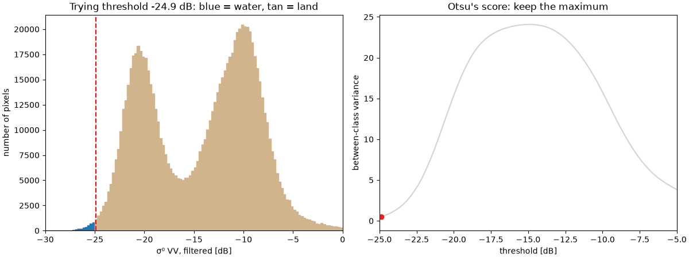

# Flood mapping in Emilia-Romagna with Sentinel-1 SAR

In May 2023 two waves of heavy rain flooded large parts of Emilia-Romagna, in northern Italy. In this project I map the flood around Lugo (Bassa Romagna) from Sentinel-1 radar images and compare two approaches against the official Copernicus EMS flood map:

- **Otsu thresholding**, a classical method that needs no training data;
- a **small U-Net** written in PyTorch, trained on floods in other countries (Sen1Floods11) and applied to Italy without retraining (zero-shot).

All the work is in one notebook, [`FloodMappingEmiliaRomagnaS1.ipynb`](FloodMappingEmiliaRomagnaS1.ipynb). It opens with a decision log of the choices I made, including the ones that did not work.


## Data

| Data | What I used | Role |
|---|---|---|
| Sentinel-1 GRD | VV + VH, σ⁰ in dB, 10 m. Pre-event 28 April 2023, post-event 22 May 2023, same relative orbit (95, descending). Downloaded with openEO from the Copernicus Data Space Ecosystem | input |
| Copernicus EMS EMSR664 | Flood polygons drawn on a COSMO-SkyMed image of 21 May 2023, rasterized on the Sentinel-1 grid | reference |
| Sen1Floods11 | Hand-labelled Sentinel-1 chips from 11 floods around the world, official split (252 train / 89 valid / 90 test) | U-Net training and test |

The study area is 29 × 32 km (11.85–12.20 °E, 44.30–44.58 °N). Pixels outside the area analysed by EMS (16%) are left out of the metrics.

## Method

- **Otsu (a):** one threshold on the post-event VV image. A single threshold for the whole image fails, because water covers only ~5% of it. So I compute Otsu only on the 10% most contrasted 2 × 2 km tiles, after a 5 × 5 median filter against speckle.
- **Otsu (b), change detection:** the same procedure on the difference post − pre.
- **U-Net:** 3 levels (16 → 128 channels, 483k weights), input VV + VH, trained on CPU. The loss is a binary cross-entropy that ignores no-data pixels and gives more weight to water (pos_weight = 3). The best epoch is chosen on the validation set.
- **Evaluation:** IoU (main metric), precision, recall and F1, computed from the confusion matrix. The EMS map and the Sen1Floods11 test set are used only for the final scores.



## Results

| Method | IoU | Precision | Recall | F1 |
|---|---|---|---|---|
| U-Net (zero-shot) | 0.622 | 0.662 | 0.910 | 0.767 |
| Otsu (a), post-event image | 0.598 | 0.706 | 0.796 | 0.748 |
| Otsu (b), change detection | 0.549 | 0.667 | 0.756 | 0.709 |

- The U-Net and Otsu (a) reach a similar IoU, but they make different errors. The U-Net finds more of the flooded area and pays with more false alarms along field edges, roads and canals; Otsu misses more water at field borders and leaves scattered speckle dots.
- The gap between the two is small compared with the uncertainty of the reference. Sentinel-1 and EMS are offset by about one pixel (10 m): shifting the Otsu map by one pixel would raise its IoU from 0.598 to 0.615. I measured the shift but did not correct it, because in a real emergency there is no reference map to align to.
- Change detection does worse than the single post-event image. It removes permanent water, but that lies mostly outside the evaluated area, and it adds the speckle of two images and fields that changed for other reasons.
- On the Sen1Floods11 test set the U-Net reaches IoU 0.67. The paper reports the mean IoU per chip: 0.31 for its network trained on the same hand labels, 0.41 for its best network and 0.36 for Otsu on VH; my U-Net gets 0.41 with this metric, with a different training setup.


*Blue: water for both the method and EMS. Red: false alarm. Orange: missed water. Grey: not evaluated.*

## Limitations

- Sentinel-1 passed on 22 May, five days after the peak of the flood and 12 hours after the image used by EMS, so some water had already drained.
- The reference is not perfect: the EMS polygons come from another sensor and are offset by about one pixel.
- In towns, buildings and water give a bright double-bounce signal, so flooded streets are missed by both methods. Water under crops and wet bare soil also cause errors.
- One event in a flat agricultural area, and one training run with a single seed and no data augmentation.

Possible next steps: data augmentation and fine-tuning on EMS maps of other events, interferometric coherence for urban areas, terrain information (HAND) to remove impossible water, and a comparison with larger datasets and tools such as Kuro Siwo and ml4floods.

## How to run

```
python -m venv .venv
.venv\Scripts\activate
pip install -r requirements.txt
```

Then run the notebook from top to bottom (Python 3.12, tested on Windows with CPU only). You need a free Copernicus Data Space Ecosystem account for the openEO downloads, and the EMS vector package EMSR664 AOI01 DEL MONIT03 from the [Copernicus EMS Rapid Mapping](https://mapping.emergency.copernicus.eu/) page, unzipped into `data/`. Sentinel-1, Sentinel-2 and Sen1Floods11 (~780 MB) are downloaded by the notebook. Training takes about one hour per run on a 6-thread CPU. `data/` and `models/` are not in the repository.

## How this project was built

I chose the case study, the data and the methods, and I ran and checked every step. The code and the text were written with the help of Claude Code, an AI coding assistant, one notebook cell at a time; I reviewed each cell and its output before moving on. The decision log at the top of the notebook records why each choice was made.

## References

- Bonafilia, D., Tellman, B., Anderson, T., Issenberg, E. (2020). *Sen1Floods11: a georeferenced dataset to train and test deep learning flood algorithms for Sentinel-1.* CVPR Workshops.
- Ronneberger, O., Fischer, P., Brox, T. (2015). *U-Net: convolutional networks for biomedical image segmentation.* MICCAI.
- Otsu, N. (1979). *A threshold selection method from gray-level histograms.* IEEE Transactions on Systems, Man, and Cybernetics.
- Martinis, S., Twele, A., Voigt, S. (2009). *Towards operational near real-time flood detection using a split-based automatic thresholding procedure on high resolution TerraSAR-X data.* Natural Hazards and Earth System Sciences.

Contains modified Copernicus Sentinel data (2023), processed with openEO on the Copernicus Data Space Ecosystem. Flood reference: Copernicus Emergency Management Service (© European Union), activation EMSR664. Sen1Floods11: Cloud to Street / Bonafilia et al. (2020). The code and text of this repository are released under the [MIT License](LICENSE); the datasets keep their own terms.

Author: Daniel Di Somma, MSc student in Internet and Multimedia Engineering (Space and Multimedia), University of Genoa.
